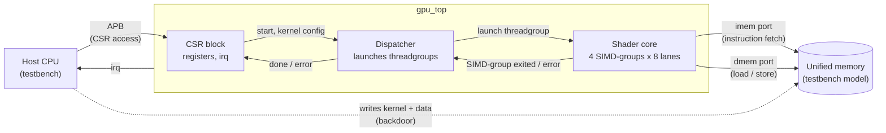
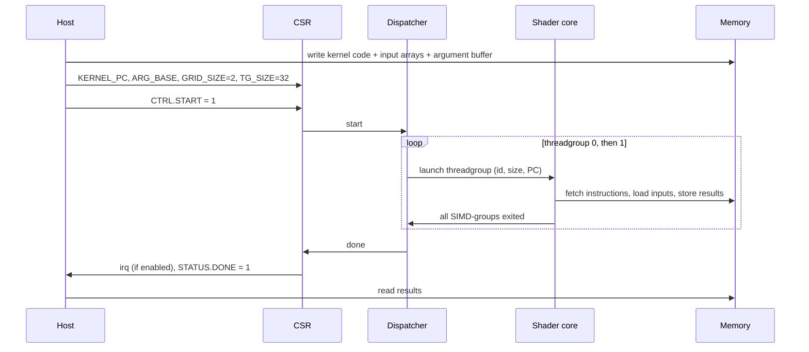

# 01 — Top-Level Architecture

## Why this matters

The top-level architecture shows which blocks exist, what each one is
responsible for, and how they talk to each other. It is the map you keep in
your head while writing RTL.

> **How Apple does it (public info):** an Apple GPU has a front end that reads
> work from memory submitted by the driver, distributes it to many shader cores,
> and shares a memory system with the CPU (unified memory). We build the same
> chain with one core.

## Block diagram

## Blocks

| Block | Responsibility |
|---|---|
| **CSR block** | APB slave. Holds the kernel configuration registers (kernel address, argument pointer, grid size, threadgroup size), status, interrupt enable/status. See [04_interfaces.md](04_interfaces.md). |
| **Dispatcher** | When `CTRL.START` is written: checks the configuration, then launches threadgroups 0 … `GRID_SIZE-1` one after the other onto the shader core. Reports done or error to the CSR block. |
| **Shader core** | Runs the SIMD-groups of one threadgroup until they all execute `EXIT`. Contains scheduler, fetch, decode, register file, ALU, load/store unit, threadgroup memory. See [02_shader_core.md](02_shader_core.md). |
| **Reset synchronizer** | Turns the external `rst_n` into an internal reset that asserts immediately and deasserts synchronously to `clk`. See [04_interfaces.md](04_interfaces.md#clock-and-reset). |

Memory is **outside** `gpu_top`. In simulation it is a model in the testbench;
in a real chip it would be the SoC memory system shared with the CPU.

## Life of a kernel launch

This example launches a vector-add kernel with 64 threads in threadgroups of
32 threads (so `GRID_SIZE` = 2, `TG_SIZE` = 32).

Step by step:

1. **Host prepares memory**: kernel instructions, input data, and an *argument
   buffer* (a small array of pointers / values the kernel reads, like the
   arguments of a C function).
2. **Host programs CSRs**: `KERNEL_PC`, `ARG_BASE`, `GRID_SIZE`, `TG_SIZE`.
3. **Host writes `CTRL.START`**. `STATUS.BUSY` goes to 1, `STATUS.DONE` and
   `STATUS.ERROR` are cleared.
4. **Dispatcher checks the configuration** (`TG_SIZE` in 1…32, `GRID_SIZE` ≥ 1,
   `KERNEL_PC` 4-byte aligned). On failure: error, stop.
5. **Dispatcher launches threadgroup *t***: it activates
   `ceil(TG_SIZE / 8)` SIMD-groups, sets their PC to `KERNEL_PC`, and sets
   their execution masks so that only threads with index < `TG_SIZE` are
   active (e.g. `TG_SIZE` = 20 → SIMD-group 2 has lanes 0–3 active).
6. **Shader core runs** until every SIMD-group has executed `EXIT`.
7. Repeat steps 5–6 for the next threadgroup.
8. **Done**: `STATUS.BUSY` = 0, `STATUS.DONE` = 1, `IRQ_STATUS.DONE` = 1, and
   `irq` goes high if `IRQ_EN.DONE` = 1.

v0.1 runs **one threadgroup at a time** on the single core. That keeps the
dispatcher trivial; running several threadgroups at once is a later iteration.

## Clock, reset and power

v0.1 has **one clock (`clk`), one reset (`rst_n`), one power domain**.
Nothing in the design needs more yet. See the flow doc for what that means
for CDC, RDC and UPF ([05_design_flow.md](05_design_flow.md)).

## Future (not in v0.1)

- More shader cores, with the dispatcher handing threadgroups to free cores.
- Shared L2 cache and an AXI4 memory interface.
- Graphics front end and TBDR blocks: vertex fetch, tiler, rasterizer,
  hidden-surface removal, tile memory resolve.

## Open questions

- Should the host load memory through the GPU (a DMA) or keep the backdoor
  model? Backdoor is enough for v0.1.
