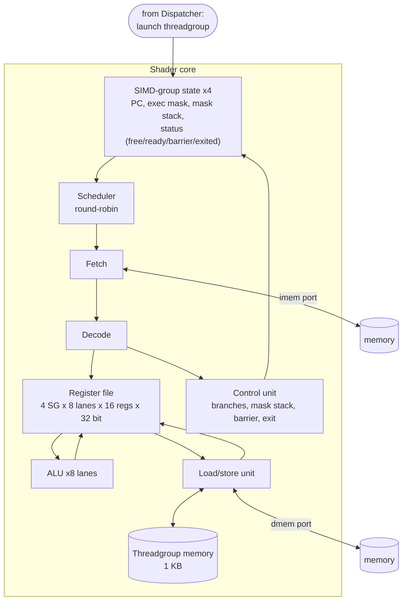
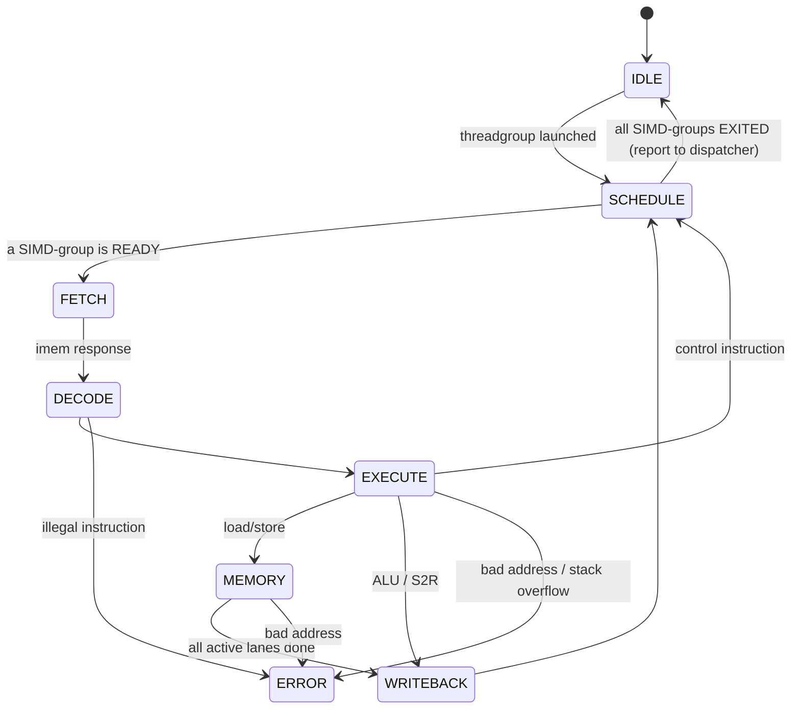

# 02 — Shader Core

## Why this matters

The shader core is where the GPU actually computes. Its key trick, compared to
a CPU core, is **SIMD execution**: one instruction is fetched once and executed
by many threads (lanes) at the same time. The second trick is **holding many
SIMD-groups at once** and switching between them, so one group waiting on
memory does not stall the core.

> **How Apple does it (public info):** an Apple GPU core runs SIMD-groups of
> 32 threads. Public analyses describe each core as having 128 FP32 ALUs,
> commonly described as four 32-wide SIMD units, and many SIMD-groups resident
> at once. The Asahi Linux ISA notes describe structured control flow driven by
> an execution-mask stack. MiniTile keeps the same concepts at a much smaller
> size: 8-wide, 4 SIMD-groups, one instruction at a time.

## Block diagram

## Execution model (v0.1: simple, not pipelined)

The core executes **one instruction for one SIMD-group at a time**, moving
through these states:

| State | What happens |
|---|---|
| `SCHEDULE` | Pick the next `READY` SIMD-group, round-robin starting after the last one picked. |
| `FETCH` | Send the SIMD-group's PC on the imem port, wait for the instruction. |
| `DECODE` | Split the instruction into fields, check the opcode, read source registers for all 8 lanes. |
| `EXECUTE` | 8 ALUs compute in parallel (one cycle). Control instructions update PC / mask here. |
| `MEMORY` | The load/store unit handles the active lanes **one lane per request**, in lane order. |
| `WRITEBACK` | Write `rd` for every **active** lane (inactive lanes keep their old value). Increment PC by 4 unless a branch was taken. |

Rough cost: an ALU instruction takes about 5 cycles; a global load takes about
`active_lanes × memory_latency` cycles. That is slow on purpose: correctness
first, pipelining comes later ([roadmap](07_roadmap.md)).

**Why switch SIMD-groups after every instruction?** It costs nothing extra in
this design and it is how real GPUs behave, so the scheduler and per-group
state are right from the start.

## SIMD-group state

Per SIMD-group slot (4 slots):

| Field | Width | Meaning |
|---|---|---|
| `status` | 2 bits | `FREE`, `READY`, `AT_BARRIER`, `EXITED` |
| `pc` | 32 | Byte address of the next instruction |
| `exec_mask` | 8 | Active lanes |
| `mask_stack[0..3]` | 4 × 8 | Saved masks for nested `IF` |
| `stack_ptr` | 3 | Number of entries on the stack (0…4) |
| `sg_id` | 2 | Index of this SIMD-group inside the threadgroup (= slot number) |

On launch, the dispatcher sets slot *s* (for *s* < `ceil(TG_SIZE/8)`) to
`READY`, `pc = KERNEL_PC`, `stack_ptr = 0`, and
`exec_mask[i] = (s*8 + i < TG_SIZE)`. Other slots stay `FREE`.

## Register file

- 16 registers × 32 bits per thread; `r0` reads as 0, writes are ignored.
- Total: 4 SG × 8 lanes × 16 regs × 32 bits = **16 Kbit (2 KB)**.
- Read: 2 source registers for all 8 lanes of one SIMD-group per cycle.
  Write: 1 destination register for the active lanes of one SIMD-group.
- v0.1 builds it from flip-flops (simple, no SRAM macro needed).
- Registers are **not** cleared on launch. Kernels must not read a register
  before writing it (the reference model will flag that).

## ALU

8 identical lanes, each a 32-bit integer ALU: add, sub, multiply (low 32 bits),
and, or, xor, shifts, set-less-than, compare (for `IF` / `BANY`). Combinational,
one cycle. No floating point in v0.1.

## Control flow and divergence

Lanes of one SIMD-group share one PC, so when they disagree on an `if`, the
core runs **both** sides and uses the execution mask to decide which lanes
write results. This is the most important GPU-specific idea in the core.

| Instruction | Action |
|---|---|
| `IF cond, rs1, rs2` | Push `exec_mask`. New `exec_mask = exec_mask & cond_per_lane`. |
| `ELSE` | `exec_mask = top_of_stack & ~exec_mask` (the lanes that were active before the `IF` but did not take it). |
| `ENDIF` | Pop: `exec_mask = top_of_stack`. |
| `BANY cond, rs1, rs2, offset` | Branch for the whole SIMD-group if **any active** lane has `cond` true. |
| `JMP offset` | Unconditional branch for the whole SIMD-group. |

Rules:
- The core does **not** skip the body of an `IF` when the mask becomes 0 in
  v0.1; it just executes it with no active lanes. (Skipping is an optimization
  for later.)
- `IF` with a full stack, or `ELSE`/`ENDIF` with an empty stack → error.
- Loops are written as an `IF` around the body plus a `BANY` back-edge: the
  lanes that are finished are masked off by the `IF`, and the loop repeats while
  any lane still needs to run. See [03_isa.md](03_isa.md#example-2-a-loop-with-divergence).

## Load/store unit

- **Global memory** (`LDG` / `STG`): address = `rs1 + sign_extend(imm)` per lane.
  For each active lane in order 0…7, one request on the dmem port; wait for its
  response before sending the next. Addresses must be 4-byte aligned.
- **Threadgroup memory** (`LDS` / `STS`): same address calculation, but into
  the 1 KB on-chip memory, one lane per cycle. Address must be aligned and
  < 1024.
- Memory ordering: within a SIMD-group, loads and stores complete in program
  order (trivially true here: one access at a time).

## Threadgroup memory

1 KB single-port memory (256 × 32 bits) inside the core. Contents are
**undefined at threadgroup launch** (a kernel must write before it reads). It
is shared by all SIMD-groups of the running threadgroup.

## Barrier

`BAR`: the SIMD-group goes to `AT_BARRIER`. When every SIMD-group of the
threadgroup is either `AT_BARRIER` or `EXITED`, all `AT_BARRIER` groups become
`READY` and continue after the `BAR`. Used together with threadgroup memory:
write → `BAR` → read what other threads wrote.

`BAR` must be executed by all SIMD-groups of a threadgroup (same as Metal's
`threadgroup_barrier`); not doing so is a kernel bug, not a hardware error.

## Exit

`EXIT` marks the SIMD-group `EXITED` regardless of the execution mask. Kernels
should only execute it outside any `IF` block. When all launched SIMD-groups
are `EXITED`, the core tells the dispatcher the threadgroup is finished.

## Errors

The first error stops the core and is reported to the CSR block with its code
and the PC of the failing instruction (codes in
[04_interfaces.md](04_interfaces.md#status-0x0c)).

## Open questions

- Pipelining: fetch the next instruction while the current one executes?
  (Iteration 4+.)
- Should loads to different lanes be sent back-to-back (multiple outstanding
  requests)? Needs a response ID; later with AXI.
