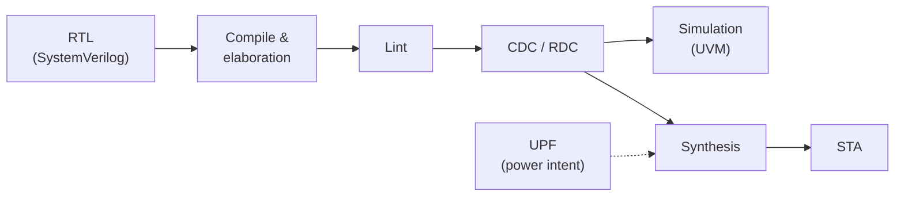

# 05 — Design Flow and Sign-off Criteria

## Why this matters

Writing RTL that simulates is only part of the job. A real chip team runs the
design through a series of checks — each one catching a different class of bug
— and an RTL change is not "done" until all of them pass. Knowing these steps
and *why* each exists is expected of any front-end GPU/ASIC engineer.

> **Industry note:** at Apple and other chip companies these steps use
> commercial tools (Synopsys VCS/SpyGlass/PrimeTime, Cadence Xcelium/Conformal,
> Siemens Questa, …). MiniTile uses open-source tools. The *concepts* and *pass
> criteria* are the same; tool names and reports differ.

## Flow overview



## Steps

| Step | Tool (open-source) | What it catches | Pass criteria for v0.1 |
|---|---|---|---|
| **Compile** | Verilator 5, slang | Syntax errors, undeclared signals, type errors | 0 errors |
| **Elaboration** | slang, Verilator | Bad parameters, port width mismatches, missing modules, unresolved hierarchy | 0 errors, 0 warnings for width mismatch |
| **Lint** | Verilator `--lint-only -Wall`, Verible lint | Inferred latches, multiple drivers, unused/undriven signals, blocking vs non-blocking misuse, style | 0 warnings, or each waiver written down with a reason |
| **CDC** (clock domain crossing) | — (see below) | Signals crossing between unrelated clocks without a synchronizer | v0.1: not applicable — single clock |
| **RDC** (reset domain crossing) | — (see below) | Flops with one reset feeding flops with a different reset | v0.1: only check — the reset synchronizer is the only async reset entry |
| **Simulation** | Verilator 5 (UVM), EDA Playground as fallback | Functional bugs | All tests in the [verification plan](06_verification_plan.md) pass, coverage goals met |
| **Synthesis** | Yosys + SkyWater 130 nm (sky130_fd_sc_hd) | Unsynthesizable code, unintended latches, unexpected logic size | No latches, no errors; area report recorded |
| **STA** (static timing analysis) | OpenSTA with an SDC file | Paths too slow for the clock | Setup and hold slack ≥ 0 at 50 MHz, typical corner |
| **UPF** (power intent) | — (see below) | Missing isolation/level shifters, wrong power sequencing | v0.1: not applicable — single always-on domain |

### CDC, RDC and UPF in v0.1

These checks exist to verify the boundaries **between** domains. v0.1 has one
clock, one reset and one power domain, so there are no boundaries yet — this is
by design, not an omission. We do **not** add domains just to have something
to check. They become real when the design needs them, for example:

| Check | Becomes needed when… |
|---|---|
| CDC | A second clock appears, e.g. the memory system runs at a different frequency than the shader core. |
| RDC | Part of the design gets its own reset, e.g. a soft reset of the shader core while the CSR block keeps its state. |
| UPF | The shader core is power-gated to save energy while the CSR block stays on. |

What v0.1 still does:
- **RDC-lite**: confirm (by review, then by script) that `rst_n` reaches flops
  only through the reset synchronizer.
- **STA SDC** declares one clock only; no false paths or clock groups are
  needed, and any that appear must be justified.

Open-source CDC/RDC/UPF tools are limited. When these checks become needed,
the plan is a rule-based script on the Yosys netlist (find flops whose data
comes from another clock domain and check they go through an approved
synchronizer cell) plus a written UPF file reviewed by hand.

## Initial SDC (constraints for STA)

```tcl
create_clock -name clk -period 20.0 [get_ports clk]
set_input_delay  4.0 -clock clk [delete_from_list [all_inputs] [get_ports {clk rst_n}]]
set_output_delay 4.0 -clock clk [all_outputs]
set_false_path -from [get_ports rst_n]   ;# async input, goes through the reset synchronizer
```

## RTL coding rules

| Rule | Why |
|---|---|
| One module per file, file name = module name | Easy to find, tools like it |
| Sequential logic only in `always_ff`, combinational only in `always_comb` | Tools check the intent; no accidental latches |
| Non-blocking (`<=`) in `always_ff`, blocking (`=`) in `always_comb` | Avoids simulation/synthesis mismatches |
| Every `always_comb` assigns every output in every path (default at top) | No latches |
| Every `case` has a `default` | No latches, defined behavior for illegal values |
| Suffixes: `_q` for flop outputs, `_d` for next-state, `_n` for active-low | Readable at a glance |
| All flops: `posedge clk`, async active-low reset from `rst_n_sync` | Single, uniform style |
| Parameters for every size in [the key parameter table](00_overview.md#key-parameters-single-source-of-truth) in one package `gpu_pkg.sv` | One place to change a size |
| Use `typedef enum logic` for FSM states and opcodes | Readable waveforms, lint checks |
| No `initial` blocks, no `#` delays in RTL | Not synthesizable |

## Planned repository layout

```
rtl/          SystemVerilog design (gpu_pkg.sv, gpu_top.sv, ...)
tb/           UVM testbench
model/        Python ISA reference model + assembler
kernels/      Example kernels in assembly
syn/          Yosys scripts, SDC, STA scripts
docs/spec/    This specification
Makefile      make lint | make sim | make syn | make sta
```

## Open questions

- Which slang/Verilator versions to pin; decided when the toolchain is set up
  (iteration 2).
