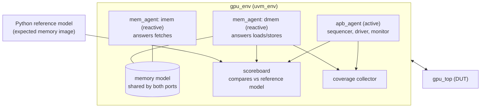

# 06 — Verification Plan

## Why this matters

In industry, verification takes more effort than design — often 2–3
verification engineers per designer. A verification plan says **what** must be
proven, **how** (tests, checkers, assertions), and **when we are done**
(coverage goals). UVM is the standard methodology for the testbench.

> **Industry note:** GPU teams verify shader cores against an ISA reference
> model (an instruction-accurate simulator written in C/C++/Python): the same
> program runs on the RTL and on the model, and the results must match.
> MiniTile does the same.

## Strategy

1. A **Python ISA reference model** executes kernels exactly as
   [03_isa.md](03_isa.md) describes (thread by thread, SIMD-group by
   SIMD-group). It is written *from the spec, not from the RTL*.
2. A **Python assembler** turns `.s` kernels into memory images used by both
   the model and the testbench.
3. The **UVM testbench** loads the same memory image, launches the kernel
   through APB, and at the end compares memory and status against the model.
4. **SVA assertions** check protocols and internal invariants every cycle.

## UVM environment

| Component | Role |
|---|---|
| `apb_agent` | Drives CSR reads/writes; monitor reports every access. |
| `mem_agent` (×2) | Reactive slave: takes requests, answers from the shared memory model. Random `req_ready` stalls and random response latency (1–10 cycles), configurable. |
| Memory model | One sparse array for both ports (unified memory). Backdoor load from the assembler's image. |
| Scoreboard | At the end of each kernel: compares `STATUS`/`ERR_CODE`/`ERR_PC` and the memory regions the test declares as outputs against the reference model's results. |
| Coverage collector | Functional coverage (below). |
| `irq` monitor | Checks `irq` rises only when enabled and the status bit is set. |

Comparison is at **end of kernel** for v0.1 (simplest). An instruction-by-instruction
trace comparison is a later improvement that finds bugs closer to their cause.

## Test list

| # | Test | Checks |
|---|---|---|
| T1 | `csr_reset_values` | Every CSR reads its reset value |
| T2 | `csr_rw` | Write/read every RW register; RO/WO behavior; `pslverr` on unmapped |
| T3 | `alu_ops` | Each ALU/immediate instruction with corner values (0, −1, max, min, shift by 0/31) |
| T4 | `special_regs` | Every `S2R` value for several `TG_SIZE` / `GRID_SIZE` combos |
| T5 | `load_store_global` | `LDG`/`STG` with all lanes and partial masks |
| T6 | `load_store_tgm` | `LDS`/`STS`, full 1 KB range |
| T7 | `if_else_nesting` | Divergence patterns, nesting depth 1–4 |
| T8 | `loop_divergent` | Example 2 (loop with different trip counts) |
| T9 | `barrier` | Example 3 (threadgroup reverse) |
| T10 | `vector_add` | Example 1 with N not a multiple of 8, several grid sizes |
| T11 | `partial_tg` | `TG_SIZE` = 1, 7, 8, 9, 31, 32 |
| T12 | `errors` | Each `ERR_CODE` 1–5 is raised with the right `ERR_PC`, GPU stops cleanly, next `START` works |
| T13 | `irq` | Done/error interrupts with enable on/off, W1C clear |
| T14 | `mem_stress` | Any kernel above with random memory stalls and latencies |
| T15 | `random_kernels` | Random legal instruction sequences from a generator, checked against the model |
| T16 | `reset_midrun` | `rst_n` asserted while busy; everything returns to reset values |

## Functional coverage goals (v0.1)

| Coverpoint | Bins |
|---|---|
| Opcode | every legal opcode executed at least once |
| Opcode × active-lane count | 0, 1, 2–7, 8 active lanes |
| Condition code × result | each cond with all-true, all-false, mixed |
| Mask stack depth | 0, 1, 2, 3, 4, overflow, underflow |
| SIMD-groups in threadgroup | 1, 2, 3, 4 |
| `TG_SIZE` | 1, 2–7, 8, 9–31, 32 |
| `GRID_SIZE` | 1, 2–15, ≥ 16 |
| Memory response latency | 1, 2–5, 6–10 cycles |
| Error code | 1–5 |
| CSR access | every register read and written |

Target: **100 % functional coverage** of the bins above, plus **line and
branch code coverage ≥ 95 %** (Verilator `--coverage`) with every gap reviewed.

## Assertions (SVA)

| Assertion | Where |
|---|---|
| `req_valid` stays high and request fields stay stable until `req_ready` | imem, dmem ports |
| At most one outstanding request per port | imem, dmem ports |
| No `rsp_valid` without an outstanding request (environment assumption) | imem, dmem ports |
| `imem_req_addr` and `dmem_req_addr` are 4-byte aligned | ports |
| APB: `penable` only after a setup cycle; signals stable during access | APB |
| No register-file write for an inactive lane | core |
| `stack_ptr` stays within 0…4 | core |
| `STATUS.BUSY` = 0 ⇒ no memory requests | top |
| FSM state is always a legal enum value | core, dispatcher |

## Tools

- **Simulator**: Verilator 5 (supports SystemVerilog classes and, in recent
  versions, a growing subset of UVM). If a UVM feature is not supported, the
  same testbench runs on EDA Playground (free access to commercial simulators).
- **Reference model / assembler**: Python 3.

## Done criteria for v0.1 RTL

All tests T1–T16 pass with several random seeds, coverage goals met, no
assertion failures, lint clean.

## Open questions

- Should the scoreboard also compare per-instruction register writes (trace
  compare)? Planned after the first end-to-end pass.
